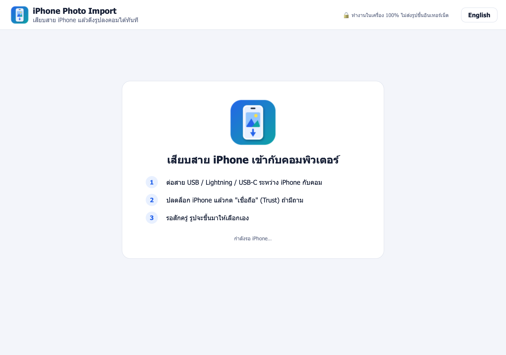
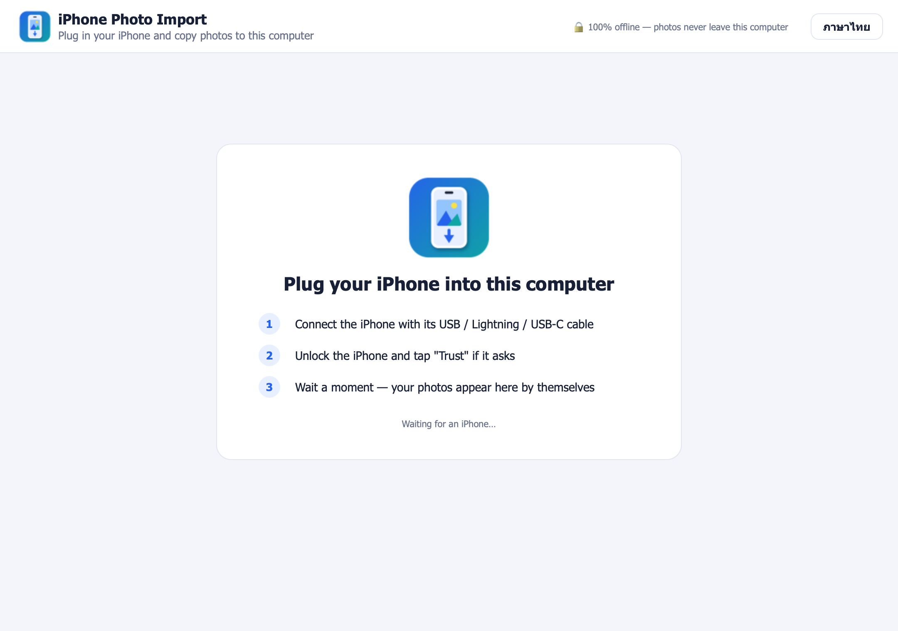

<div align="center">


# iPhone Photo Import

**เสียบสาย iPhone แล้วดึงรูปลงคอมได้ทันที ไม่ต้องลงโปรแกรมอื่น ไม่ต้องใช้ iCloud**<br>
**Plug in your iPhone and copy photos to your computer — no iCloud, no extra apps**


<a href="https://github.com/madara1150/iphone-photo-import/releases/latest/download/iPhonePhotoImport-Windows-Setup.exe"></a>
<a href="https://github.com/madara1150/iphone-photo-import/releases/latest/download/iPhonePhotoImport-Windows-Portable.zip"></a>
<a href="https://github.com/madara1150/iphone-photo-import/releases/latest/download/iPhonePhotoImport-macOS.dmg"></a>

[ทุกเวอร์ชัน / All versions](https://github.com/madara1150/iphone-photo-import/releases)

[ภาษาไทย](#-ภาษาไทย) · [English](#-english)



</div>

---

## 🇹🇭 ภาษาไทย

ถ่ายรูปงานด้วย iPhone แล้วต้องเอามาใส่รายงานในคอม? เปิดโปรแกรม เสียบสาย กดปุ่มเดียว รูปก็อยู่ในคอมแล้ว
แปลงไฟล์ HEIC เป็น JPG ให้เอง จึงลากไปวางใน Word / PowerPoint / Google Docs ได้ทันที

### ทำอะไรได้บ้าง

| ✨ ฟีเจอร์ | คำอธิบาย |
|---|---|
| 🔌 เสียบแล้วใช้ได้เลย | โปรแกรมเจอ iPhone เอง ไม่ต้องตั้งค่า ไม่ต้องใช้ iCloud หรือ AirDrop |
| 📅 เลือกช่วงเวลา | ดูเฉพาะรูป **วันนี้ / 7 วัน / 30 วัน / ทั้งหมด** รูปของวันนี้ถูกเลือกไว้ให้แล้ว |
| ✅ เลือกรูปได้ | กดที่รูปเพื่อเลือก/ไม่เลือก หรือกด "เลือกทั้งหมด" |
| 🖼️ HEIC → JPG | แปลงอัตโนมัติ เปิดได้ทุกโปรแกรม รูปตั้งตรง วันที่และข้อมูล EXIF ยังอยู่ครบ |
| 🗂️ แยกโฟลเดอร์ตามวัน | เก็บเป็น `รูปภาพ/iPhone Import/2026-11-04/…` หาง่ายตอนทำรายงาน |
| 🔁 ไม่ดึงซ้ำ | จำว่ารูปไหนดึงไปแล้ว ขึ้นป้าย "ดึงแล้ว" และไม่เลือกให้อีก |
| 🛡️ ปลอดภัย | ไม่ลบรูปจาก iPhone ไม่เขียนทับไฟล์เดิมในคอม ทำงานในเครื่อง 100% |
| 🎬 วิดีโอ | ติ๊ก "รวมวิดีโอ" ถ้าต้องการวิดีโอด้วย (คลิปสั้นของ Live Photo ถูกข้ามให้) |

### ดาวน์โหลด / ติดตั้ง

- **Windows 10/11** — ดาวน์โหลด [ตัวติดตั้ง (.exe)](https://github.com/madara1150/iphone-photo-import/releases/latest/download/iPhonePhotoImport-Windows-Setup.exe) หรือ [แบบไม่ต้องติดตั้ง (.zip)](https://github.com/madara1150/iphone-photo-import/releases/latest/download/iPhonePhotoImport-Windows-Portable.zip)
  ต้องมีแอปฟรี **Apple Devices** (หรือ iTunes) จาก Microsoft Store เพื่อให้ Windows รู้จัก iPhone
- **macOS 11+** — ดาวน์โหลด [ไฟล์ .dmg](https://github.com/madara1150/iphone-photo-import/releases/latest/download/iPhonePhotoImport-macOS.dmg) แล้วลากไอคอนไปที่ Applications

### วิธีใช้

1. เปิดโปรแกรม
2. เสียบสาย iPhone เข้ากับคอม
3. ปลดล็อก iPhone แล้วกด **"เชื่อถือ" (Trust)** ถ้ามีถาม
4. รูปของวันนี้จะขึ้นมาและถูกเลือกไว้ (เปลี่ยนเป็น 7 วัน / 30 วัน / ทั้งหมด ได้ด้านบน)
5. กด **"ดึง … รายการลงคอม"** แล้วกด **"เปิดโฟลเดอร์"** เมื่อเสร็จ

### คำถามที่พบบ่อย / แก้ปัญหา

<details>
<summary><b>เสียบแล้วโปรแกรมไม่เจอ iPhone</b></summary>

- ปลดล็อกหน้าจอ iPhone ค้างไว้ และกด "เชื่อถือ" (Trust)
- ลองสายเส้นอื่น บางเส้นชาร์จได้อย่างเดียว ส่งข้อมูลไม่ได้
- **Windows:** ติดตั้งแอป **Apple Devices** (หรือ iTunes) แล้วถอดเสียบใหม่ ถ้ายังไม่ขึ้น ลองเปิด File Explorer ดูว่ามี "Apple iPhone" ใน This PC หรือไม่
- ถ้าเคยกด "ไม่เชื่อถือ" ไปแล้ว: บน iPhone ไปที่ การตั้งค่า → ทั่วไป → ถ่ายโอนหรือรีเซ็ต iPhone → รีเซ็ต → รีเซ็ตตำแหน่งที่ตั้งและความเป็นส่วนตัว แล้วเสียบใหม่
</details>

<details>
<summary><b>macOS บอกว่าเปิดโปรแกรมไม่ได้ (Gatekeeper)</b></summary>

คลิกขวาที่ไอคอนโปรแกรม → **เปิด (Open)** → **เปิด** อีกครั้ง หรือไปที่ System Settings → Privacy & Security → กด **Open Anyway**
ถ้า macOS ถามว่าให้โปรแกรมเข้าถึงรูปในอุปกรณ์หรือกล้องไหม ให้กด **อนุญาต**
</details>

<details>
<summary><b>Windows ขึ้น "Windows protected your PC" (SmartScreen)</b></summary>

กด **More info** → **Run anyway** (โปรแกรมยังไม่ได้ซื้อใบรับรองการเซ็นโค้ด)
</details>

<details>
<summary><b>บน Windows ได้ไฟล์ JPG ทั้งที่ iPhone ถ่ายเป็น HEIC</b></summary>

เป็นเรื่องปกติ iPhone แปลงให้เองเมื่อเปิด การตั้งค่า → รูปภาพ → "ถ่ายโอนไปยัง Mac หรือ PC: อัตโนมัติ"
</details>

<details>
<summary><b>อยากดึงรูปเดิมซ้ำอีกครั้ง</b></summary>

เอาติ๊ก "ซ่อนรูปที่ดึงไปแล้ว" ออก แล้วกดเลือกรูปนั้น โปรแกรมจะเก็บเป็นไฟล์ใหม่ เช่น `IMG_0001 (2).JPG` ไม่เขียนทับของเดิม
</details>

### Build เอง (สำหรับนักพัฒนา)

```bash
python3 -m venv .venv
.venv/bin/pip install -r requirements-dev.txt
.venv/bin/python main.py          # รันโปรแกรม
.venv/bin/python -m pytest        # รันเทสต์
./build_mac.sh                    # → dist/iPhonePhotoImport-macOS.dmg
```

บน Windows (Python 3.10+, Inno Setup 6.5+ ถ้าต้องการตัวติดตั้ง): `build_windows.bat`
→ `dist\iPhonePhotoImport-Windows-Setup.exe` และ `dist\iPhonePhotoImport-Windows-Portable.zip`

เบื้องหลัง: macOS ใช้ ImageCaptureCore (ตัวเดียวกับแอป Image Capture) · Windows อ่าน iPhone ผ่าน Windows Shell (เหมือนที่ File Explorer เห็น)

### License

MIT © 2026 Tanathip

---

## 🇬🇧 English

Took photos on your iPhone and need them in a report on your computer? Open the app, plug in the phone, press one button — done.
HEIC photos are converted to JPG automatically, so they drop straight into Word, PowerPoint or Google Docs.

<div align="center">

</div>

### What it does

| ✨ Feature | Description |
|---|---|
| 🔌 Plug and go | Finds the iPhone by itself — no setup, no iCloud, no AirDrop |
| 📅 Pick a range | Show **Today / 7 days / 30 days / All**; today's photos are pre-selected |
| ✅ Choose photos | Click a photo to select or deselect it, or use "Select all" |
| 🖼️ HEIC → JPG | Converted automatically, upright, with the date and EXIF data kept |
| 🗂️ A folder per day | Saved as `Pictures/iPhone Import/2026-11-04/…` |
| 🔁 No duplicates | Remembers what was already imported and marks it "Imported" |
| 🛡️ Safe | Never deletes anything on the phone, never overwrites files, 100% offline |
| 🎬 Videos | Tick "Include videos" to copy videos too (Live Photo clips are skipped) |

### Download / install

- **Windows 10/11** — [installer (.exe)](https://github.com/madara1150/iphone-photo-import/releases/latest/download/iPhonePhotoImport-Windows-Setup.exe) or [portable (.zip)](https://github.com/madara1150/iphone-photo-import/releases/latest/download/iPhonePhotoImport-Windows-Portable.zip).
  Windows needs the free **Apple Devices** app (or iTunes) from the Microsoft Store to talk to an iPhone.
- **macOS 11+** — [.dmg](https://github.com/madara1150/iphone-photo-import/releases/latest/download/iPhonePhotoImport-macOS.dmg), then drag the app to Applications.

### How to use

1. Open the app
2. Plug the iPhone into the computer
3. Unlock the iPhone and tap **Trust** if it asks
4. Today's photos appear, already selected (switch to 7 days / 30 days / All at the top)
5. Press **Import … items**, then **Open folder** when it's done

### FAQ / troubleshooting

<details>
<summary><b>The app doesn't see my iPhone</b></summary>

- Keep the iPhone unlocked and tap "Trust"
- Try another cable — some only charge
- **Windows:** install the **Apple Devices** app (or iTunes) and plug in again; check that "Apple iPhone" shows up under This PC in File Explorer
- If you tapped "Don't Trust" before: on the iPhone go to Settings → General → Transfer or Reset iPhone → Reset → Reset Location & Privacy, then plug in again
</details>

<details>
<summary><b>macOS says the app can't be opened (Gatekeeper)</b></summary>

Right-click the app → **Open** → **Open**, or go to System Settings → Privacy & Security → **Open Anyway**.
If macOS asks whether the app may access photos on devices or the camera, click **Allow**.
</details>

<details>
<summary><b>Windows shows "Windows protected your PC" (SmartScreen)</b></summary>

Click **More info** → **Run anyway** (the app is not code-signed with a paid certificate).
</details>

<details>
<summary><b>On Windows I get JPG files although the iPhone shoots HEIC</b></summary>

That's normal: the iPhone converts them itself when Settings → Photos → "Transfer to Mac or PC" is set to Automatic.
</details>

<details>
<summary><b>I want to import a photo again</b></summary>

Untick "Hide already imported" and select it. It is saved as a new file such as `IMG_0001 (2).JPG`; nothing is overwritten.
</details>

### Build it yourself

```bash
python3 -m venv .venv
.venv/bin/pip install -r requirements-dev.txt
.venv/bin/python main.py          # run
.venv/bin/python -m pytest        # tests
./build_mac.sh                    # → dist/iPhonePhotoImport-macOS.dmg
```

On Windows (Python 3.10+, Inno Setup 6.5+ for the installer): `build_windows.bat`
→ `dist\iPhonePhotoImport-Windows-Setup.exe` and `dist\iPhonePhotoImport-Windows-Portable.zip`

Under the hood: macOS uses ImageCaptureCore (the framework behind Image Capture); Windows reads the iPhone through the Windows Shell, the same view File Explorer shows.

### License

MIT © 2026 Tanathip
